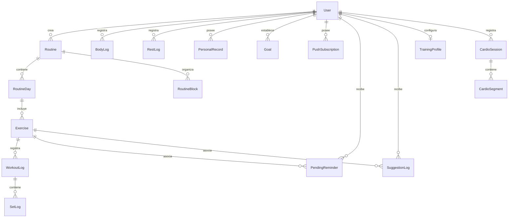

# NexLift — Diccionario del Modelo de Datos (Prisma / PostgreSQL)

Actualización Fase 6: el modelo vigente conserva 17 entidades y tiene 166 columnas,
propiedad directa y snapshots en WorkoutLog, Exercise desvinculable/archivable y
retención SQL restrictiva. Este diccionario v3 y el inventario 2.1 son referencias
históricas. Ver [decisiones y catálogo actual](../server/audit/database/PHASE-6-COMPLETE.md).

> Especificación exhaustiva de entidades, tipos de datos, relaciones, índices y reglas de integridad referencial.
> **Versión:** 3.0.0 | **Esquema:** `server/prisma/schema.prisma`

> Este diccionario v3 es histórico y parcial. El schema real contiene 17 modelos;
> el inventario completo está en [INVENTORY.md](../server/audit/postgresql/INVENTORY.md).
> La tabla de comprobantes vive en SQL separado
> `nexlift_operations."IdempotencyRecord"`, no en el DMMF de Prisma. Ver
> [3.1](../server/audit/operations/PHASE-3.1.md). Baseline **PROVISIONAL**.
> Fase 4.1 conserva schema, migraciones, datos y rutas; no ejecuta migraciones
> persistentes ni crea una segunda definición de los modelos en shared.

---

## 📐 Diagrama Entidad-Relación (Mermaid)

---

## 🗄️ Diccionario de Entidades y Campos

### 1. `User` (Cuenta y Preferencias de Usuario)
Representa la cuenta del atleta, credenciales y configuración del sistema.

| Campo | Tipo | Nulo | Default | Descripción e Invariantes |
|---|---|---|---|---|
| `id` | `String` | No | `cuid()` | Identificador único CUID (Clave Primaria). |
| `username` | `String` | No | — | Nombre de usuario único `@unique`, indexado. |
| `email` | `String` | No | — | Correo electrónico único `@unique`, indexado. |
| `passwordHash` | `String` | No | — | Hash bcrypt de la contraseña. |
| `firstName` | `String` | No | — | Nombre de pila. |
| `lastName` | `String` | No | — | Apellido. |
| `phone` | `String?` | Sí | — | Teléfono de contacto opcional. |
| `birthDate` | `DateTime?`| Sí | — | Fecha de nacimiento (anclada a mediodía UTC). |
| `avatarUrl` | `String?` | Sí | — | URL de foto de perfil (Cloudinary / Catbox). |
| `securityQuestion` | `String?` | Sí | — | Pregunta para recuperación de cuenta sin SMTP. |
| `securityAnswerHash`| `String?`| Sí | — | Hash bcrypt de la respuesta de seguridad normalizada. |
| `isActive` | `Boolean` | No | `true` | Estado activo de la cuenta. |
| `tokenVersion` | `Int` | No | `0` | Contador para revocación inmediata de JWTs emitidos previamente. |
| `lastReengagementNotifiedAt` | `DateTime?` | Sí | — | Fecha del último push de re-enganche enviado (máx 1/día). |
| `lastBackupAt` | `DateTime?` | Sí | — | Fecha del último respaldo exitoso a Cloudinary. |
| `lastBackupError` | `String?` | Sí | — | Mensaje de error si falló el último respaldo. |
| `creatineReminderEnabled` | `Boolean` | No | `false` | Activa recordatorios diarios de creatina. |
| `creatineReminderTime` | `String` | No | `"16:00"`| Hora base programada (formato HH:mm en CDMX). |
| `lastCreatineReminderDate` | `String?` | Sí | — | Fecha YYYY-MM-DD del último push de creatina enviado. |
| `lastCreatineReminderStage`| `Int` | No | `0` | Etapa del recordatorio de creatina enviada hoy (1, 2 o 3). |
| `createdAt` | `DateTime` | No | `now()` | Fecha de registro. |
| `updatedAt` | `DateTime` | No | auto | Fecha de última actualización. |
| `lastLogin` | `DateTime?` | Sí | — | Fecha del último inicio de sesión exitoso. |

---

### 2. `Routine` (Rutina de Entrenamiento)
Colección de días de entrenamiento organizados bajo un plan común.

| Campo | Tipo | Nulo | Default | Descripción e Invariantes |
|---|---|---|---|---|
| `id` | `String` | No | `cuid()` | Identificador único CUID. |
| `name` | `String` | No | — | Nombre de la rutina (ej. "PPL Hipertrofia"). |
| `description` | `String?` | Sí | — | Notas o descripción del plan. |
| `isActive` | `Boolean` | No | `false` | Indica si es la rutina en uso actualmente. |
| `source` | `String` | No | `"manual"`| Origen: `'manual'` o `'ai'` (rutina generada por IA). |
| `adaptiveDeloadUntil` | `DateTime?` | Sí | — | Fecha límite de la ventana de descarga adaptativa. |
| `lastAdaptiveCheckAt` | `DateTime?` | Sí | — | Cooldown de 7 días entre evaluaciones de descarga. |
| `userId` | `String?` | Sí | — | Clave foránea hacia `User.id` (`onDelete: Cascade`). |
| `createdAt` / `updatedAt` | `DateTime` | No | — | Timestamps de auditoría. |

- **Índices:** `@@index([userId])`, `@@index([userId, isActive])`.

---

### 3. `RoutineBlock` (Mesociclos de Periodización)
Fases de entrenamiento programadas dentro de una rutina.

| Campo | Tipo | Nulo | Default | Descripción |
|---|---|---|---|---|
| `id` | `String` | No | `cuid()` | Clave primaria CUID. |
| `name` | `String` | No | — | Nombre del bloque (ej. "Bloque Acumulación"). |
| `phase` | `String` | No | `"custom"`| `'accumulation'` \| `'intensification'` \| `'deload'` \| `'custom'`. |
| `order` | `Int` | No | `0` | Orden de secuencia dentro de la rutina. |
| `durationWeeks` | `Int` | No | `4` | Duración proyectada en semanas (informativo). |
| `startedAt` | `DateTime?`| Sí | — | Fecha de inicio. El bloque activo es el de `startedAt` no nulo más reciente. |
| `routineId` | `String` | No | — | Clave foránea hacia `Routine.id` (`onDelete: Cascade`). |

---

### 4. `RoutineDay` (Día de Rutina)
Estructura diaria asignada a un día específico de la semana o generado por IA.

| Campo | Tipo | Nulo | Default | Descripción e Invariantes |
|---|---|---|---|---|
| `id` | `String` | No | `cuid()` | Clave primaria CUID. |
| `dayName` | `String` | No | — | Nombre decorativo ("Torso", "Pierna", o fecha ISO en días IA). |
| `isRestDay` | `Boolean` | No | `false` | Marca si es día de descanso programado. |
| `order` | `Int` | No | `0` | Orden visual dentro de la rutina. |
| `splitLabel` | `String?` | Sí | — | Etiqueta de split (ej. "Push", "Pull") en rutinas IA. |
| `weekday` | `Int?` | Sí | — | **Única fuente de verdad de día:** 0=Dom..6=Sáb en manuales. `null` en IA. |
| `routineId` | `String` | No | — | Clave foránea hacia `Routine.id` (`onDelete: Cascade`). |

---

### 5. `Exercise` (Ejercicio de Rutina)
Definición de un ejercicio dentro de un día de entrenamiento.

| Campo | Tipo | Nulo | Default | Descripción |
|---|---|---|---|---|
| `id` | `String` | No | `cuid()` | Clave primaria CUID. |
| `name` | `String` | No | — | Nombre del ejercicio (ej. "Press de Banca con Barra"). |
| `muscleGroup` | `String?`| Sí | — | Grupo muscular en español ("Pecho", "Piernas", etc.). |
| `targetSets` | `Int` | No | — | Número de series objetivo programadas (default 3 o 4). |
| `targetReps` | `String` | No | — | Rango de repeticiones objetivo (ej. `"8-12"` o `"5"`). |
| `restSeconds` | `Int?` | Sí | — | Segundos de descanso recomendados (default 90). |
| `note` | `String?` | Sí | — | Notas técnicas o de ejecución para el ejercicio. |
| `order` | `Int` | No | `0` | Posición en el entrenamiento. |
| `isUnilateral` | `Boolean` | No | `false` | Flag si se registra de forma independiente izquierda/derecha. |
| `routineDayId` | `String` | No | — | Clave foránea hacia `RoutineDay.id` (`onDelete: Cascade`). |

- **Índices:** `@@index([routineDayId])`, `@@index([name])`, `@@index([routineDayId, name])`.

---

### 6. `WorkoutLog` (Sesión de un Ejercicio)
Registro real de ejecución de un ejercicio en una fecha determinada.

| Campo | Tipo | Nulo | Default | Descripción |
|---|---|---|---|---|
| `id` | `String` | No | `cuid()` | Clave primaria CUID. |
| `date` | `DateTime` | No | `now()` | Fecha y hora de realización en UTC. |
| `exerciseId` | `String` | No | — | Clave foránea hacia `Exercise.id` (`onDelete: Cascade` en DB, `Restrict` en lógica de negocio). |
| `notes` | `String?` | Sí | — | Observaciones de la sesión. |

- **Índices:** `@@index([exerciseId])`, `@@index([date])`, `@@index([exerciseId, date])` (Optimiza la consulta caliente de historial para Smart Loading).

---

### 7. `SetLog` (Serie Individual de Entrenamiento)
Datos detallados de cada serie completada dentro de una sesión.

| Campo | Tipo | Nulo | Default | Descripción e Invariantes |
|---|---|---|---|---|
| `id` | `String` | No | `cuid()` | Clave primaria CUID. |
| `setNumber` | `Int` | No | — | Número ordinal de la serie (1, 2, 3...). |
| `weight` | `Float` | No | — | Peso levantado en kg (o lado izquierdo en unilateral). |
| `reps` | `Int` | No | — | Repeticiones logradas. |
| `rpe` | `Int?` | Sí | — | **Guarda `10 - RIR`** (Inversión deliberada). RIR 0 = rpe 10. |
| `completed` | `Boolean` | No | `true` | Marca de serie completada. |
| `weightRight` | `Float?` | Sí | — | Peso en kg para el lado derecho (unilateral). |
| `repsRight` | `Int?` | Sí | — | Repeticiones para el lado derecho (unilateral). |
| `workoutLogId`| `String` | No | — | Clave foránea hacia `WorkoutLog.id` (`onDelete: Cascade`). |

- **Índices:** `@@index([workoutLogId])`.

---

### 8. `PersonalRecord` (Récord Personal)
Mejor marca histórica registrada por ejercicio.

| Campo | Tipo | Nulo | Default | Descripción |
|---|---|---|---|---|
| `id` | `String` | No | `cuid()` | Clave primaria CUID. |
| `exerciseName` | `String` | No | — | Nombre del ejercicio normalizado en minúsculas. |
| `weight` | `Float` | No | — | Peso del récord en kg. |
| `reps` | `Int` | No | — | Repeticiones con las que se logró el récord. |
| `estimated1RM`| `Float?` | Sí | — | 1RM estimado por fórmula de Epley. |
| `date` | `DateTime` | No | `now()` | Fecha en que se batió la marca. |
| `userId` | `String?` | Sí | — | Clave foránea hacia `User.id` (`onDelete: Cascade`). |

---

### 9. `BodyLog` (Composición Corporal y Adherencia)
Registro diario de peso, bioimpedancia, fotografías y hábitos de adherencia.

| Campo | Tipo | Nulo | Default | Descripción |
|---|---|---|---|---|
| `id` | `String` | No | `cuid()` | Clave primaria CUID. |
| `date` | `DateTime` | No | `now()` | Fecha del registro. |
| `weight` | `Float?` | Sí | — | Peso corporal en kg. |
| `photoUrl` | `String?` | Sí | — | Enlace a Cloudinary de la fotografía de progreso. |
| `bmi` | `Float?` | Sí | — | Índice de masa corporal. |
| `bodyFat` | `Float?` | Sí | — | Porcentaje de grasa corporal. |
| `muscleMass` | `Float?` | Sí | — | Masa muscular en kg. |
| `bmr` | `Float?` | Sí | — | Tasa metabólica basal en kcal. |
| `bodyWater` | `Float?` | Sí | — | Porcentaje de agua corporal. |
| `visceralFat` | `Float?` | Sí | — | Nivel de grasa visceral (1-30). |
| `boneMass` | `Float?` | Sí | — | Masa ósea en kg. |
| `protein` | `Float?` | Sí | — | Porcentaje de proteína corporal. |
| `creatineTaken` | `Boolean?`| Sí | `false` | **Hábito:** Creatina tomada hoy (5g). |
| `dietCompliant` | `Boolean?`| Sí | `false` | **Hábito:** Déficit calórico o dieta cumplida. |
| `zeroLiquidCalories`| `Boolean?`| Sí | `false` | **Hábito:** Cero calorías líquidas consumidas. |
| `userId` | `String?` | Sí | — | Clave foránea hacia `User.id` (`onDelete: Cascade`). |

---

### 10. `Goal` (Objetivo de Periodización)
Meta de fuerza calculada matemáticamente para alcanzar una marca específica.

| Campo | Tipo | Nulo | Default | Descripción |
|---|---|---|---|---|
| `id` | `String` | No | `cuid()` | Clave primaria CUID. |
| `exerciseName` | `String` | No | — | Nombre del ejercicio meta. |
| `muscleGroup` | `String?`| Sí | — | Grupo muscular asociado. |
| `targetWeight` | `Float` | No | — | Peso objetivo en kg. |
| `targetReps` | `Int` | No | — | Repeticiones objetivo. |
| `createdAt` | `DateTime` | No | `now()` | Fecha de fijación del objetivo. |
| `achievedAt` | `DateTime?`| Sí | — | Fecha de consecución sellada por el backend. |
| `currentOneRepMax` | `Float?` | Sí | — | Snapshot del 1RM inicial al crear la meta. |
| `experienceLevel` | `String?` | Sí | — | Nivel ('beginner', 'intermediate', 'advanced'). |
| `frequencyPerWeek` | `Int?` | Sí | — | Frecuencia semanal de entrenamiento del movimiento. |
| `completedWeeks` | `Int[]` | No | `[]` | Array con los números de semana marcados como cumplidos. |
| `userId` | `String` | No | — | Clave foránea hacia `User.id` (`onDelete: Cascade`). |

---

### 11. `PendingReminder` (Alarma de Descanso Persistida)
Almacén en base de datos para recordatorios de fin de descanso, tolerante a reinicios del servidor.

| Campo | Tipo | Nulo | Default | Descripción |
|---|---|---|---|---|
| `id` | `String` | No | `cuid()` | Clave primaria CUID. |
| `userId` | `String` | No | — | Identificador del usuario. |
| `exerciseId` | `String` | No | — | Clave foránea hacia `Exercise.id` (`onDelete: Cascade`). |
| `fireAt` | `DateTime` | No | — | Momento UTC exacto en que debe sonar la alarma. |
| `nextExerciseName`| `String?`| Sí | — | Nombre del ejercicio siguiente a anunciar en el push. |

- **Restricción Única:** `@@unique([userId, exerciseId])` (Garantiza dedup estricto: solo una alarma pendiente por ejercicio).

---

### 12. `SuggestionLog` (Telemetría de Calibración)
Registro analítico de cada sugerencia de carga calculada y/o aplicada.

| Campo | Tipo | Nulo | Default | Descripción |
|---|---|---|---|---|
| `id` | `String` | No | `cuid()` | Clave primaria CUID. |
| `userId` | `String` | No | — | Usuario que recibió la sugerencia. |
| `exerciseId` | `String` | No | — | Ejercicio evaluado. |
| `date` | `DateTime` | No | `now()` | Fecha de la sugerencia. |
| `suggestedWeight`| `Float` | No | — | Peso sugerido en kg. |
| `suggestedReps` | `Int` | No | — | Repeticiones sugeridas. |
| `phase` | `String?` | Sí | — | Fase activa al momento de la sugerencia. |
| `source` | `String` | No | — | Origen: `'client'` (tocó SUGERIDO), `'shortcut'` (Atajo iOS), `'intra'` (serie 2+). |

---

### 13. `TrainingProfile` (Perfil para Rutina IA)
Configuración 1:1 por usuario para alimentar la generación de la rutina diaria.

| Campo | Tipo | Nulo | Default | Descripción |
|---|---|---|---|---|
| `id` | `String` | No | `cuid()` | Clave primaria CUID. |
| `userId` | `String` | No | — | Clave foránea única `@unique` hacia `User.id`. |
| `goal` | `String` | No | — | `'hypertrophy'` \| `'strength'` \| `'general'`. |
| `daysPerWeek` | `Int` | No | — | Días disponibles de entrenamiento por semana (2-6). |
| `equipment` | `String[]` | No | — | Subconjunto de: `barbell`, `dumbbell`, `machine`, `cable`, `bodyweight`. |
| `experienceLevel`| `String` | No | — | `'beginner'` \| `'intermediate'` \| `'advanced'`. |
