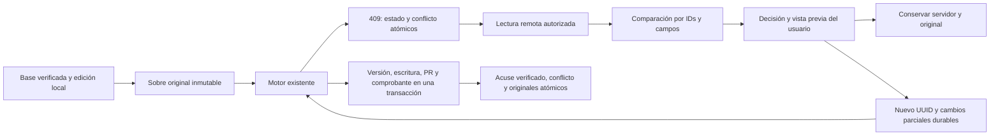

# NexLift v4.0 — Fase 3.4

Estado: **COMPLETADO en desarrollo y ensayo aislado**. **973 pruebas aprobadas: 917 anteriores + 56 nuevas**. Producción intacta y deshabilitada por defecto. Baseline PostgreSQL **PROVISIONAL**. Sin commits, despliegues ni avance a 3.5.

## 1. Causa y tipos de conflicto

Se revisaron el protocolo 3.1, la lectura versionada, el motor 3.2, los repositorios/coordinación/migración 3.3, `api.js`, EditSession, Workout, WorkoutLog/SetLog, transacciones, PR y los informes previos. `expectedVersion` es un SHA-256 del ID de sesión, ejercicio, fecha, notas y todos los SetLog ordenados por `setNumber` e ID. No es un contador ni el reloj de un dispositivo. La autorización procede de la cadena sesión → ejercicio → día → rutina → cuenta autenticada.

Hallazgos confirmados: el 409 conservaba la operación pero no ofrecía reconciliación; los sobres no garantizaban una fotografía base; `workout.replaceSets` borraba y recreaba todas las series incluso al cambiar un único peso. Un índice de array no permite identificar una serie después de eso. Los borradores sí podían contener la sesión leída, pero no deben transformarse por conjetura en base de operaciones antiguas.

Ahora se distinguen cambios independientes, cambios simultáneos de campo, eliminación contra edición, sesión no disponible, cambios de orden, campos que afectan a PR, ausencia de autorización y operaciones sin base/identidades verificables. Un 404 autorizado no revela si la sesión fue eliminada o pertenece a otra cuenta: se presenta como no disponible para esta cuenta. No se inventa un tombstone ni su propietario.

## 2. Arquitectura de resolución

Se conserva el único motor de sincronización 3.2. `conflictResolution.js` organiza lecturas, comparación y decisiones; nunca implementa otro transporte/replay. El repositorio de conflictos usa la misma base y coordinación Dexie. Una decisión local se guarda con un nuevo UUID, hash, base remota y referencia al conflicto **antes** de cualquier POST. Luego el motor existente consulta el comprobante y, solo si falta con el código esperado, envía esa operación.



No hay fusión automática, política de último cambio ni PUT alternativo. Incluso los cambios demostrablemente independientes requieren confirmación.

## 3. Archivos modificados

Nuevos en cliente: `services/sessionChanges.js`, `services/conflictResolution.js`, `storage/conflictRepository.js`, `components/layout/ConflictStatus.jsx`, `test/conflict-cases.js` y `test/conflict-harness.html`.

Adaptados: `operationProtocol.js`, `operationSync.js`, `operationRuntime.js`, `api.js`, `storage/database.js`, `storage/runtime.js`, `storage/operationRepository.js`, `storage/migrationService.js`, `OperationStatus.jsx`, `EditSession.jsx`, `Workout.jsx`, `Settings.jsx` y `client/.env.example`. EditSession conserva IDs al editar, crea UUID para series nuevas y permite editar notas con la flag. Su fotografía base permanece separada de los campos editados y se conserva en el borrador. Un borrador anterior sin campo `notes` conserva las notas de su sesión base; un null explícito sigue siendo un valor distinto. Workout conserva la fotografía completa y los IDs al completar una sesión parcial; Settings conserva la sesión revisada antes de solicitar eliminación. Los borradores anteriores que solo tienen un hash no adquieren por conjetura una fotografía nueva.

Backend: nuevo `services/sessionPatch.js`; extensiones en `operationContract.js`, `workoutOperations.js` y `routes/operations.js`. Configuración/documentación: `server/.env.example`, `server/package.json`, README y esta carpeta. No se incorporan dependencias.

Ensayos nuevos: `run-conflict-integration.mjs`, `conflict.integration.test.js`, `fixtures/conflict-http.mjs`, `fixtures/conflict-browser.mjs`, `check-conflicts.mjs` y `verify-conflicts.mjs`. Las pruebas, runners e informes anteriores permanecen conservados.

El worktree ya contenía cambios de fases previas. El diff total contra Git no representa exclusivamente esta fase. [Evidencia de conservación](preservation-evidence.json): 21 archivos protegidos contrastados por SHA-256 con 3.3.

## 4. Contratos API utilizados y extensión compatible

Se reutilizan `GET /api/v1/workout-capabilities`, `GET /api/v1/workout-sessions/:logId`, `GET /api/v1/workout-operations/:operationId` y `POST /api/v1/workout-operations`.

La extensión mantiene `protocolVersion: 1` y el tipo SQL `workout.replaceSets`; añade una variante explícita `changes`, mutuamente excluyente con `sets`. Los clientes anteriores y sus hashes/acuse siguen siendo válidos. Las capacidades anuncian `resolutions: {version: 1, partialSets: true, stableSetIds: true, deleteResolution: true}` únicamente si ambas funciones están habilitadas. Sin esa capacidad el motor bloquea la escritura correspondiente; no hace fallback a reemplazo/PUT. `workout.delete` admite también una referencia `resolution` para la eliminación expresamente revisada. El backend rechaza reutilizar el UUID original como UUID de una resolución, incluso si aquella operación aún no tenía comprobante SQL.

Ejemplo de variante nueva:

```json
{
  "kind": "workout.replaceSets",
  "source": "pwa",
  "operationId": "UUID nuevo por decisión",
  "performedAt": "instante ISO de la decisión",
  "logId": "sesión autorizada",
  "expectedVersion": "SHA-256 de la versión remota revisada",
  "changes": {
    "updates": [{"id": "SetLog estable", "fields": {"weight": 82.5}}],
    "session": {"notes": "Nota seleccionada"}
  },
  "resolution": {
    "conflictId": "UUID original del conflicto",
    "originalOperationId": "mismo UUID original",
    "decision": "manual"
  }
}
```

`changes` también admite `additions: [{id, fields}]`, `removals: [id]`, `order: [todos los IDs finales]` y `session.date`. Las adiciones requieren todos los campos deportivos. El parser rechaza campos desconocidos, valores no finitos, tipos erróneos, IDs duplicados, operaciones contradictorias sobre un ID, órdenes incompletos, metadatos de resolución sin patch y la mezcla `sets`/`changes`. Conserva límites deportivos previos: hasta 50 series, pesos 0–2000, repeticiones enteras 0–1000, RPE entero 0–10/null y booleanos estrictos. `null` en lados/RPE/notas es un valor explícito; ausente significa no modificar.

Dentro de la transacción se vuelve a comprobar propiedad, versión y pertenencia de cada serie a la sesión. Un ID de otra sesión/cuenta no puede actualizarse. Las adiciones no pueden apropiarse de un ID existente. Un fallo revierte series, notas, fecha, PR y comprobante. La respuesta conserva el resultado completo, versión, hash y referencia a la resolución; no se reutiliza el acuse de la operación original.

No cambian `schema.prisma`, baseline, migración 3.1 ni sus CHECK de tipos: la variante conserva un tipo ya admitido. No se añade tabla PostgreSQL ni migración.

## 5. Persistencia local y migración

Con la flag 3.4, Dexie pasa de versión 2 a **3**, física IndexedDB **30**, mediante una actualización aditiva. Las versiones 1 y 2 se conservan. Se agregan:

| Tabla | Clave e índices | Contenido |
| --- | --- | --- |
| conflicts | `[ownerId+id]`, ownerId, `[ownerId+operationId]`, `[ownerId+status]` | UUID del conflicto = UUID original; sobre/payload/base originales, sesión, motivo, detección, revisión CAS, dependientes, observación, estado, ID del intento y resultado |
| conflictHistory | `[ownerId+conflictId+id]`, `[ownerId+conflictId]` | Detección, fotografías/diferencias observadas, decisiones, propuestas, estados, acuses y resolución de intentos descendientes |

El motor materializa conflicto y estado en la misma transacción. El inventario descubre también conflictos y dependencias previamente bloqueadas, sin duplicar conflictos por recibir varios 409. Cerrar/posponer la comparación no borra el registro. Los originales no se reescriben, ni siquiera tras resolver.

La preparación guarda decisión e ID de operación atómicamente con revisión CAS, por lo que dos pestañas no pueden crear dos intentos para la misma decisión. La confirmación local agrupa receipt, evento, conflicto, estado original conservado y trazabilidad de resoluciones encadenadas en una transacción. `confirmed` y `resolved_preserved` son absorbentes frente a respuestas locales tardías. El nuevo estado conservado solo puede establecerlo una decisión transaccional del repositorio: no se acepta como estado inicial ni como evento legacy arbitrario. Tampoco se acepta una confirmación como estado inicial sin acuse.

No hay HTTP, SHA-256, timers ni interacción del usuario dentro de transacciones Dexie. Se conservan Web Locks, lease/fencing y BroadcastChannel sin datos sensibles. Las comprobaciones de sesión se realizan antes y después de lecturas, escritura local y HTTP.

La migración original de localStorage, sus copias literales y sus barreras siguen activas. No se elimina almacenamiento anterior. Sin la flag, una base todavía v2 utiliza el adaptador anterior; un cliente sin soporte para v3 falla de forma explícita ante una base ya actualizada. **Desactivar la flag no convierte ni borra v3**: para recuperar/exportar esos registros debe usarse el cliente compatible con v3. No se promete rollback destructivo ni doble escritura.

No hay TTL, poda, archivo ni borrado automáticos. Una fase futura podría archivar solo tras verificar resultados de todos los intentos, resolver dependencias y disponer de exportación comprobada; esta fase no ejecuta ese archivo.

## 6. Reglas de comparación

`baseSnapshot` es opcional en el sobre original, fuera del payload HTTP. Contiene dueño, sesión completa y versión. Se verifica propietario/contexto de captura y se recalcula el mismo hash 3.1; las series deben tener IDs únicos y pertenecer al log. La lectura remota procede del endpoint autenticado y se verifica igual. El backend no confía en la base del cliente para autorizar escrituras.

Se comparan notas, fecha, peso, repeticiones, RPE, completed, peso/repeticiones derechos, adiciones, eliminaciones y orden. RIR se presenta como derivación de RPE, sin fórmula nueva de PR. Las identidades son SetLog.id, nunca índices de array. Una edición de una serie eliminada no se resucita. Un orden local que no contiene exactamente la estructura propuesta se bloquea. Las adiciones remotas se conservan al añadir una serie local.

WorkoutLog no tiene campos `status` ni `isUnilateral`. Se explica la disponibilidad/eliminación de sesión y se compara `completed` por serie. El flag unilateral pertenece a Exercise: se muestra como contexto no editable y los lados se resuelven por los campos existentes de SetLog. No se inventan columnas ni permisos de edición de ejercicio.

Las operaciones legacy `replaceSets` sin identidades no adquieren correspondencias posicionales. Sin base completa verificable se permite conservar servidor, revisar original e historial y exportar; no se ofrece aplicar/fusionar lo que no puede identificarse. No se adjudican registros ambiguos a la cuenta abierta.

Una colisión de identidad al crear entrenamiento/descanso no se presenta como una sesión eliminada: permanece bloqueada en el journal para revisar/exportar su operación y comprobante. El reconciliador de sesiones exige `logId`; no fabrica un conflicto de sesión a partir de una creación.

## 7. Opciones de resolución e interfaz

El panel integrado anuncia «Este entrenamiento cambió en otro dispositivo», muestra originales/local/remoto y marca cambios simultáneos, estructuras incompatibles y posible impacto sobre PR. Permite revisar historial, exportar, posponer y cerrar manteniendo el conflicto visible. Los estados separan original conservado localmente, propuesta aún sin aplicar y escritura con comprobante verificado.

**Conservar servidor:** relee y comprueba que coincide con la observación revisada, no envía una escritura remota y marca el original `resolved_preserved`; base, payload, historial y dependientes permanecen recuperables. La aceptación registra versión/estado leído y fecha. Esa lectura no bloquea futuras ediciones de otros dispositivos ni congela la sesión remota para siempre.

**Aplicar mis cambios:** presenta todos los cambios locales identificables en una vista previa. La confirmación relee la versión y construye una operación parcial nueva sobre esa versión. Si hay estructuras incompatibles se exige revisión, sin aplicación parcial silenciosa de la opción completa.

**Revisión manual:** selección local/servidor por cada campo o cambio estructural compatible. El preview enumera cada valor remoto y su resultado propuesto. Confirmar reconstruye los campos desde la comparación persistida y rechaza cambios ajenos a la selección. El servidor aplica únicamente el patch y vuelve a verificar la versión dentro de la transacción. Los campos no seleccionados permanecen como estaban en el servidor.

Una solicitud local de eliminar la sesión se presenta como decisión de eliminación completa, con todas las diferencias remotas disponibles y una advertencia explícita en la vista previa. Solo esa selección permite producir otro `workout.delete` con UUID nuevo, versión actual y referencia al conflicto; se recalculan PR y se conserva un tombstone idempotente. Una sesión remota ya inexistente no se recrea. No se intenta una eliminación parcial disfrazada de una selección de peso/notas.

Si el remoto cambia entre lectura y POST, nace otro conflicto ligado al intento nuevo. Resolverlo conserva todos los IDs, decisiones y acuses y cierra la cadena de conflictos ancestros de forma transaccional. Un intento pendiente/resultado desconocido no permite crear otro ID: se consulta/reintenta el mismo con el motor existente.

## 8. Operaciones dependientes

Se identifican dependencias transitivas mediante IDs y se muestran en el conflicto. Las operaciones bloqueadas se conservan, sin mutar su payload, versión o UUID. Una decisión activa recibe prioridad controlada para poder reconciliarse aunque el original esté en conflicto; no habilita un replay general de la cola.

Resolver la operación anterior no reanuda dependientes con versiones obsoletas. Cada dependiente se revisa y, si la intención y base son verificables, genera una operación nueva sobre el remoto actual. Los campos ya aceptados siguen en su original. Las dependencias ausentes, ciclos y estados anteriores sin resolver bloquean esa propuesta. La captura normal construye dependencias hacia operaciones previas; el repositorio rechaza auto-dependencias y duplicados.

## 9. PR, transacciones e integridad

La escritura parcial usa el mismo bloqueo de cuenta/cadena propietaria y transacción Serializable 3.1. `sessionVersion` se comprueba dentro del backend antes de tocar datos. Actualizaciones usan SetLog.id; solo los borrados seleccionados se eliminan. El orden se renumera conservando IDs al modificar estructura/orden. Después se llama al mismo `recalcPRForExercise`, con el mismo cliente transaccional, y se inserta el comprobante en esa transacción.

`personalRecords.js`, `workoutTransaction.js` y las fórmulas permanecen idénticos por SHA-256. El frontend no calcula PR. Se comprueban aumentos/descensos, repeticiones, lados unilaterales, eliminación de serie ganadora, empate con sesión más antigua y eliminación de sesión ganadora, además de reconstruir los PR al final contra el servicio existente.

## 10. Concurrencia y resultados de integración

Ensayos exclusivamente sintéticos: conflictos de peso, reps, RIR/RPE, notas, completed y ambos lados; cambios independientes de campos/series; adiciones simultáneas; eliminación contra edición; fecha y orden; remoto inexistente; aceptar servidor; intención local; selección manual; nuevo remoto durante preview y entre última lectura/POST; dos resoluciones remotas sobre la misma versión; tres versiones y reconexión cinco días después; dependientes; UUID repetido y contenido incompatible; fallos de almacenamiento en el acuse; autorización; base manipulada; legacy; migración local y flags/capacidades ausentes.

Se verifica el estado final real de PostgreSQL, IDs/contenido de series, versiones, comprobantes, PR y ausencia de series huérfanas; también se inspeccionan tablas reales de IndexedDB. No basta un HTTP 200. El runner crea un clúster PG nuevo en puerto loopback aleatorio, verifica PGDATA/system_identifier/marcador y aplica la migración provisional solamente a esa base desechable. La base negativa sin migración rechaza capacidades/escrituras y no crea la tabla.

## 11. Pruebas de navegador

Microsoft Edge real en Windows, IndexedDB nativo y Dexie 4.4.6. Clientes lógicos independientes usan bases separadas; la competencia local usa también dos pestañas Edge reales contra la misma base. Se comprueba una única decisión durable mediante CAS.

El ensayo cierra el proceso real del navegador con una resolución aún sin acuse local tras perder la respuesta **después del COMMIT PostgreSQL**, reinicia el servidor HTTP manteniendo la base desechable, reabre el mismo perfil y recupera el mismo UUID por su comprobante. Los contadores SQL permanecen sin duplicación.

La interfaz React real se prueba con el panel, comparación, preview local, selección manual, confirmación, comprobación SQL de notas y recarga. La matriz anterior conserva las pruebas PWA/SW, congelación de pestañas, leases, upgrade, cuota, transacciones interrumpidas y 1.000 operaciones de 3.3. No se utilizan mocks de IndexedDB para estas garantías.

No hay dispositivos físicos ni Safari/iOS disponibles: multidispositivo se simula mediante clientes independientes; el cierre/reinicio de Edge sí es real. No se afirma validar una instalación PWA de iOS ni un corte eléctrico físico.

## 12. Total de pruebas, builds y lint

Resultado final: **973 pruebas aprobadas, sin fallos ni omisiones: las 917 anteriores y 56 nuevas**. Los **34 comandos terminaron con código 0**, incluidos ambos builds y los checks. Se verificaron contra el workspace los SHA-256 de **66 artefactos**, además de los 21 archivos protegidos de la fase anterior. [Matriz](phase34-evidence.json), [evidencia PostgreSQL/navegador](integration-evidence.json) y [conservación](preservation-evidence.json).

La matriz concluyó el `2026-10-19T03:07:42.166Z` —18 de octubre, horario CDMX—. El ensayo PostgreSQL/navegador dejó 43 sesiones, 85 series, 2 descansos y 109 comprobantes sintéticos. La comprobación final encontró cero series huérfanas y coincidencia de PR con su reconstrucción transaccional. Las diferencias remotas, UUID y estados se verificaron también en IndexedDB real.

El verificador instala dependencias en una copia limpia sin `.env` ni URLs externas, verifica primero las 730 pruebas históricas sobre su fixture baseline congelado, luego 70 de operaciones, 70 de sincronización y 47 de almacenamiento: **917 anteriores**. Ejecuta los casos nuevos, checks, build por defecto sin flags, build con las tres flags y smoke repetido con dependencias de producción. El smoke de 48 casos repetidos no se suma al total único.

Comando: `npm run verify:conflicts` desde `server`, con Node **24.22.0**. Este entorno dispone del binario fijado bajo `%TEMP%/nexlift-node24-tools/`; no se cambia el Node global. PostgreSQL 18 se localiza mediante el helper existente. El runner no acepta argumentos ni bases externas.

Lint global final: **27 errores y 3 advertencias preexistentes; cero errores y cero advertencias nuevos**. El checker verificó los módulos añadidos/modificados y el mismo total global. `git diff --check` de los cambios rastreados de esta fase pasó. Los builds conservan la advertencia histórica de tamaño del paquete PDF; no fallaron.

## 13. Activación y límites para la Fase 3.5

Para un ensayo aislado se requieren `VITE_WORKOUT_OPERATIONS_ENABLED=true`, `VITE_INDEXEDDB_ENABLED=true`, `VITE_CONFLICT_RESOLUTION_ENABLED=true` y backend `NEXLIFT_OFFLINE_SYNC_ENABLED=true`, `NEXLIFT_CONFLICT_RESOLUTION_ENABLED=true`, con capacidades SQL reales disponibles. Los ejemplos dejan todas esas funciones en false. El backend impide habilitar la extensión de resolución en NODE_ENV=production, incluso si la flag está en true.

Pendiente para consideración futura, sin implementarlo: dispositivos físicos/Safari, activación de baseline de producción autorizada por separado, importación guiada de exportaciones, archivo de evidencias, reconstrucción explícita de estructuras legacy incompatibles, recuperación manual de series/sesiones eliminadas y reconciliación del flag unilateral global de Exercise. No se hace resurrección automática ni se sugiere reintroducir datos pendientes a mano como forma de reintentar.

El usuario confirma incluso fusiones independientes. El inventario conserva cada lectura/decisión; no hay poda, por lo que su crecimiento debe evaluarse antes de una política futura de archivo. IndexedDB sigue sujeto a permisos/cuota/expulsión del navegador y no cifra la cuenta en el dispositivo. Se mantienen las exportaciones recuperables de 3.3.

## 14. Producción y respaldos

No se accedió a PostgreSQL de producción ni al clúster persistente de staging, ni se cargaron URLs/contraseñas de sus archivos privados. No se usaron datos personales. Solo se leyó el timestamp del estado de staging: permanece `2026-10-18T21:46:32.5512450Z`. Su release y servicios no fueron activados, migrados ni modificados.

No se cambian servicios ni contratos de backup de fases anteriores, schema Prisma, SQL previo, cola legacy, Atajos, SW ni cálculos deportivos. Las evidencias anteriores permanecen como registro histórico; los nuevos resultados se guardan en `audit/conflicts/`.

La carpeta temporal fallida de 3.3 cuya limpieza fue rechazada permanece conservada; esta fase no reintenta ese borrado. Los runners nuevos detienen y limpian exclusivamente sus propios clústeres/perfiles temporales mediante comprobación de ruta. No se realizaron commits ni despliegues.

Un ensayo intermedio agotó la espera de la prueba heredada de congelación de pestaña mientras se ejecutaban dos matrices. Se conservan su diagnóstico privado y copia de código en `C:/Users/guerr/AppData/Local/Temp/nexlift-phase34-verification-hvjbGl`; sus servicios de ensayo quedaron detenidos. La validación final pasó ese caso con las mismas aserciones y sin otra matriz en paralelo. La copia temporal de la matriz exitosa se limpió al concluir.

Referencias primarias para transacciones: [Dexie](https://dexie.org/docs/Dexie/Dexie.transaction()), [Prisma](https://www.prisma.io/docs/orm/fundamentals/transactions) y [aislamiento PostgreSQL 18](https://www.postgresql.org/docs/18/transaction-iso.html). La comparación por campos, CAS local y conservación de intenciones son decisiones de diseño de NexLift verificadas por los ensayos descritos.

## 15. Estado de entrega

**COMPLETADO en desarrollo y ensayo aislado**. Se cumplen los criterios de detección/comparación verificables, tres decisiones revisables, conservación de originales y dependientes, versiones dentro de la transacción, UUID/comprobantes persistentes, PR consistentes, persistencia local, cuentas aisladas y pruebas previas/nuevas aprobadas. Producción permanece intacta y deshabilitada. No se avanza a la Fase 3.5.
