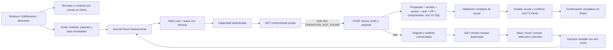

# NexLift v4.0 — Fase 3.5

Estado: **COMPLETADO en desarrollo**. Matriz final aprobada el 19 de octubre de 2026: **1.007 pruebas únicas (973 anteriores + 34 nuevas)**. Ninguna activación productiva. Baseline y SQL 3.1 **PROVISIONALES**.

## 1. Arquitectura offline final

Se leyeron completos los informes 3.1, 3.2, 3.3 y 3.4 y se inspeccionaron los módulos reales de API, transacciones, PR, autenticación, transporte, sincronización, Dexie, migración, coordinación, conflictos, formularios y Service Worker. Se conserva un solo protocolo y un solo motor.

Referencias conservadas: [3.1](../operations/PHASE-3.1.md), [3.2](../sync/PHASE-3.2.md), [3.3](../storage/PHASE-3.3.md), [3.4](../conflicts/PHASE-3.4.md).



El SW sirve shell/assets y deja API/Authorization exclusivamente en red. No guarda JWT en IndexedDB, no transforma cachés en comprobantes y no crea otro sincronizador en segundo plano. La aplicación debe abrirse/reabrirse para enviar. Las fórmulas deportivas, backend de PR y esquema SQL permanecen intactos.

| Estado local | Entrada y salida permitidas |
| --- | --- |
| `pending` | Captura durable; puede pasar a `syncing` con identidad, conexión y liderazgo válidos |
| `syncing` | Consulta/envío en curso; una reapertura reconcilia el mismo UUID |
| `retry_scheduled` | Red/408/429/5xx; conserva contenido y respeta backoff/Retry-After antes de `syncing` |
| `paused_auth` | 401 real; conserva datos. Reanudación tras verificar la credencial propietaria |
| `conflict` | 409; nunca reescribe payload, versión ni UUID original |
| `blocked_validation` / `blocked_forbidden` | 400/404/422 o 403; revisión y exportación; no replay ciego |
| `blocked_incompatible` | Capacidades/acuse incompatibles; no fallback legacy |
| `blocked_dependency` | Antecedente pendiente/ambiguo; no rebase ni avance de dependientes |
| `blocked_migration` | Colisión/corrupción legacy; originales conservados y explicación visible |
| `confirmed` | Acuse verificado persistido atómicamente; absorbente |
| `resolved_preserved` | Decisión explícita conserva el original; absorbente y distinto de una confirmación SQL |

Los conflictos transitan `unresolved → deferred / awaiting_receipt / resolved_server`; un intento confirmado produce `resolved_local`, y otro 409 produce `reconflict` y su conflicto descendiente. CAS impide dos decisiones locales simultáneas. La cola mantiene FIFO: un bloqueo detiene también independientes; el panel ahora lo explica. Solo el intento de resolución autorizado puede recibir la prioridad controlada de 3.4. No se introduce bypass general.

## 2. Escenarios end-to-end ejecutados

El runner usa React compilado con Vite, Edge real, IndexedDB nativo/Dexie, Express/Prisma y PostgreSQL 18 desechable. El formulario se rellena mediante eventos DOM de React, incluidos peso, reps, RIR y botones de completar/guardar. Las lecturas auxiliares de rutina/historial del fixture consultan PostgreSQL con propietario; los endpoints v1, middleware de autenticación, transacciones, comprobantes y PR usan los módulos reales.

| Escenario | Comprobación |
| --- | --- |
| A: entrenamiento offline | Formulario completo → Dexie; SQL sin cambios y sin confirmación; cierre/reapertura con API caída y recarga con red del navegador desconectada; mismo UUID; reconexión automática; sets, PR, acuse y panel confirmados una vez |
| B: respuesta perdida | Socket descartado tras COMMIT real; se mantiene el corte hasta liberación explícita; reinicio real HTTP/Edge; GET recupera el acuse original sin otro POST de aplicación ni otra fila |
| C: cambio de día | Instante `2026-10-18T05:59:59.999Z`, día CDMX `2026-10-17`, sincronización posterior a `2026-10-18T06:00Z`; se contrastan fecha de sesión y columnas del comprobante SQL |
| D: dispositivos | Dos procesos/perfiles Edge independientes cargan la misma sesión; ediciones reales de la misma serie; segundo cliente offline; 409, tabla comparativa, preview y decisión; cierre después de preparar y antes de enviar; reapertura confirma otro UUID y conserva original/historial |
| E: PostgreSQL caído | Parada/arranque reales del clúster propio; operación retenida sin acuse y credencial conservada; recuperación y una escritura final |
| F: legacy y borradores | Copia interrumpida y reanudada, v1 válido, borrador y array ambiguo; hashes/IDs y originales intactos, sin atribuir al usuario abierto |
| G: pestañas | Dos pestañas reales reintentan la misma resolución; se verifica un único efecto. La regresión 3.3 conserva además congelación CDP, lease vencido y rechazo del escritor antiguo por fencing |

También se prueba el borrador unilateral sin guardar: cierre/reapertura offline, modo elegido y ambos lados recuperados. No se recrea una sesión a partir de un borrador ni de una coincidencia de historial.

## 3. Matriz de fallos y resultados

| Límite | Fallo ejecutado | Estado final exigido |
| --- | --- | --- |
| Antes del commit IDB | Excepción de cuota inyectada en tabla metadata dentro de TX real | Cero operación/metadata parcial; error y reintento local posible |
| Después del guardado local, antes de fetch | Reapertura de base/perfil | UUID/hash/payload intactos; única creación remota |
| Durante HTTP, antes de COMMIT | Socket interrumpido y error SQL real tras INSERT de datos/acuse | Rollback completo; mismo UUID puede completar luego |
| Después del COMMIT, antes de respuesta | Socket destruido por fixture de ensayo | SQL confirmado, IDB pendiente; recuperación por comprobante |
| Después del acuse, antes/durante actualización Dexie | Excepción de cuota en receipts dentro de TX real | Estado sin confirmación parcial ni receipt; siguiente GET confirma sin segundo POST |
| Durante migración legacy | Checkpoint interrumpido tras lote; regresión conserva tres etapas y cierre de navegador | Reanudación, copia verificada, originales y registros ambiguos conservados |
| Durante comparación | API cortada al consultar remoto | Error visible, original/historial intactos; lectura reanudada |
| Durante resolución | Dos pestañas/decisiones y cambios remotos, incluidos ensayos 3.4 | CAS/versiones; sin overwrite ni decisión concurrente silenciosa |
| Después de preparar resolución, antes de enviar | Adaptador de ensayo suspende llamada al motor; cierre real Edge | Propuesta y UUID nuevos durables; recuperación con mismo intento |
| Durante reinicio HTTP | Parada/arranque real, misma base desechable | Mismo comprobante y sin duplicación |
| Desconexión prolongada | Instante histórico preservado y cliente retrasado cinco días de 3.4 | Sin TTL; versión obsoleta revisada, nunca rebasada |
| Líder congelado | Congelación/reanudación CDP + vencimiento controlado del lease, regresión 3.3 | Escritor tardío rechazado, journal conservado |

La cuota es una **inyección**, no un disco físicamente lleno. Los checkpoints y el avance del reloj del lease son simulaciones explícitas. Los cierres de pestaña/proceso, reinicios HTTP, parada PostgreSQL y conexiones/socket sí se ejecutan realmente. Ninguno equivale a un apagón físico. Chromium puede repetir una conexión perdida antes de recibir headers; por ello el fixture mantiene el corte hasta que el controlador lo libera. La garantía se comprueba por UUID, acuse y filas SQL, sin asumir que HTTP entrega una sola vez.

## 4. Invariantes verificadas

| Invariante | Evidencia automática |
| --- | --- |
| Un efecto por operación confirmada | Conteos antes/después, PK `(userId, operationId)`, mismo resourceId y comprobante |
| Un UUID no confirma dos payloads | Hash canónico cliente/servidor; colisiones y concurrencia de las suites 3.1–3.4 |
| Confirmación local válida | Validación de dueño/hash/fecha/contenido/versión; TX estado+acuse; fallo IDB y recuperación por GET |
| Operación no confirmada íntegra | IDs, payloads y hashes comparados tras reinicios, fallos, bloqueos y exportación |
| Aislamiento de cuentas | JWT auténticos sintéticos, revocación SQL, expiración, cambio de usuario y respuesta tardía; exportación filtrada |
| Dependencias ordenadas | FIFO y bloqueos conservados; cola mixta de 1.000 con error inicial y dependiente final no avanza ni entra en bucle |
| Conflicto explícito | Dos editores reales, 409, tabla/preview, nuevo UUID, original `resolved_preserved`, historial y versión remota |
| Fechas originales | `performedAt`, `performedDay`, `WorkoutLog.date` y `createdAt` SQL contrastados |
| PR confirmado | Verificación del ejercicio del formulario y reconstrucción final con el servicio transaccional existente |
| Borradores/originales recuperables | Reaperturas reales, revisiones Dexie, fuentes raw y claves legacy sin eliminar |
| Resolución repetida no duplica | Reinicio y dos pestañas; un comprobante nuevo y el mismo ID estable de serie |
| Integridad relacional | Cero SetLog huérfanos; reconstrucción PR coincidente al final del ensayo |

## 5. Defectos descubiertos y corregidos

1. **Workout no podía reabrir su borrador sin API.** La UI dependía de volver a descargar rutina/historial. Se reproduce con operación durable y API desconectada: el panel conserva datos pero el día no abre. Ahora el borrador Dexie incluye contexto del día, dueño y fecha; solo esa cuenta/día puede recuperarlo ante red/5xx, con aviso de historial posiblemente desactualizado. No se cachea API privada ni se usa el contexto como prueba de confirmación/autorización remota.
2. **La recarga podía habilitar Guardar sobre una creación pendiente.** La reconciliación de historiales retiraba la marca local si SQL aún no tenía sesión. Se recupera la intención por su UUID en el journal, se muestran sus series y se protege contra otro guardado. La UI distingue guardado local pendiente de comprobante. Se ensaya cierre, recarga sin red y reconexión con exactamente una sesión.
3. **Modo unilateral no persistido en Workout.** Los lados estaban en el borrador, pero reabrir restablecía el modo del catálogo y podía excluirlos del próximo payload. La reproducción de Edge falló al recuperar el input derecho. Ahora se guarda la elección del formulario por ejercicio en el mismo borrador/revisión; no cambia el flag global Exercise ni ningún cálculo. Se conservan los dos lados y se agregan etiquetas accesibles para distinguirlos.
4. **Navegación privada podía contaminar el shell del SW.** El branch `navigate` se ejecutaba antes de API/Authorization. Tres reproducciones fallaron mostrando una escritura del JSON privado sobre `index.html`. La exclusión privada se evalúa primero, también `/api` exacto. Las mismas pruebas exigen cero lecturas/escrituras de caché. No cambia VERSION, skipWaiting, claim, registro ni política operativa de activación.
5. **Amplificación de consultas/render con colas grandes.** Una lectura real de 5.000 registros hizo 5.000 relecturas individuales de operación y tardó 845 ms, además de sus consultas de eventos. Los avisos frecuentes podían multiplicar ese coste. La lectura usa lotes e índice existente; motor/UI pueden omitir historial en vistas y la lectura pública predeterminada lo conserva. Conflictos/dependientes y conteos usan índices existentes. Los paneles agrupan avisos durante 250 ms y el journal muestra páginas de 50 con acceso a todas las siguientes y exportación completa. Es una ventana de presentación, nunca un límite de cola ni una poda. Un ensayo anterior al agrupamiento tardó 95,3 s para 1.000 operaciones con React visible; la matriz final registró 25,4 s en ese recorrido, con las limitaciones de medición local descritas en la sección 7.
6. **Exportación local sin verificación integral del archivo.** Se añade manifiesto SHA-256 canónico y verificador de estructura, propietario, sobres, fuentes y correspondencia de confirmaciones con comprobantes. El formato v1 y las propiedades originales se conservan. Un archivo histórico sin manifiesto requiere `allowUnverified:true` y se informa como no verificado; no se importa automáticamente. Un hash sin clave detecta corrupción accidental, **no es una firma** contra un atacante capaz de recalcularlo.
7. **Bloqueo de migración sin etiqueta específica.** `blocked_migration` ahora tiene explicación visible y activa el aviso de revisión/FIFO. No se desbloquean ni modifican sus originales automáticamente.

Los defectos se verifican con reproducciones automatizadas y regresión completa. Las iteraciones del fixture también detectaron errores de instrumentación: ruta de historial equivocada, conteo que confundía entrenamientos y descansos, credencial de revocación mal preparada, espera demasiado breve para carga con React y desconexión de CDP por recarga esperada del SW. Se corrigieron los fixtures; no se relajaron las aserciones de integridad. La única corrección a la preparación de pruebas históricas se detalla abajo; sus casos y aserciones se conservan.

La primera matriz completa aprobó las 730 pruebas históricas iniciales y las 70 de operaciones; se detuvo después por `EBUSY` al retirar `postgres.private.log` del clúster desechable, una vez aprobadas las 40 aserciones PostgreSQL de esa etapa. No fue una aserción fallida de aplicación. El proceso PostgreSQL ya había parado (`postmaster.pid` ausente). Se conservan `C:/Users/guerr/AppData/Local/Temp/nexlift-phase35-verification-qMVOXT` y el remanente sintético `nexlift-operation-tests-UbbkH8`, sin limpieza manual ni modificación de las pruebas por ese incidente; la matriz se repitió en otra copia nueva. [Diagnósticos](diagnostic-evidence.json).

La segunda matriz se detuvo con 165 pruebas del cliente aprobadas y 11 fallidas después del cambio de fecha del equipo al 19 de octubre. Se aisló la causa en el fixture: `vi.clearAllTimers()` de Vitest 4.1.10 reiniciaba el desplazamiento del reloj falso a la hora de instalación y descartaba el día fijado por la prueba. Las operaciones quedaban correctamente bloqueadas por `original_day` antes de alcanzar la aserción prevista. `offlineSync.regression.test.js` conserva ahora `Date.now()` alrededor de las cuatro limpiezas de temporizadores; sus 66 casos pasan. La comparación del archivo normalizando exclusivamente ese helper y esas cuatro llamadas coincide con el original, sin cambiar casos ni aserciones. No cambia el reloj ni la protección temporal de la aplicación. Se conserva la copia diagnóstica `nexlift-phase35-verification-Uz534e`. [Documentación de Vitest](https://vitest.dev/api/vi.html#vi-clearalltimers), [evidencia y hashes](diagnostic-evidence.json).

## 6. Archivos modificados

Aplicación: `client/src/pages/Workout.jsx`, `services/api.js`, `services/operationSync.js`, `storage/operationRepository.js`, `storage/conflictRepository.js`, `storage/runtime.js`, `components/layout/OperationStatus.jsx`, `ConflictStatus.jsx`, `OfflineStorageStatus.jsx` y `public/sw.js`. Nuevo: `storage/localBackup.js`.

Ensayo nuevo: `client/test/stabilization-harness.html`, `stabilization-cases.js`; `server/test/run-stabilization-integration.mjs`, `stabilization.integration.test.js`, `stabilization-sw.test.js`, `fixtures/stabilization-http.mjs`, `fixtures/stabilization-browser.mjs`, `check-stabilization.mjs`, `verify-stabilization.mjs`.

Preparación histórica corregida: `client/src/services/offlineSync.regression.test.js`, exclusivamente conservación del reloj falso durante la limpieza de temporizadores; casos y aserciones originales preservados.

Documentación/comandos: `server/package.json`, README y `server/audit/offline/`. Sin dependencias nuevas ni cambios a lockfiles, schema Prisma, SQL, backend de negocio, fórmulas, transportes, colas legacy o configuración operativa. El diff Git incluye cambios de fases anteriores y no es un listado exclusivo de 3.5.

## 7. Carga y mediciones

Los tamaños 10/100/1.000/5.000 usan 10% entrenamientos y 90% descansos, cada uno con UUID/payload válido propio, IndexedDB real, API real y SQL. Se guardan tiempo de apertura, listado, reapertura, sincronización, pulsos del event loop y retraso máximo, bytes JSON exportables, estimate del origen, solicitudes GET/POST, IDs únicos y ausencia de POST redundantes tras repetir el motor.

Mediciones finales de la matriz, con Edge 155.0.4283.62, Node 24.22.0 y PostgreSQL 18.4 en Windows:

| Operaciones | Apertura ms | Listado ms | Reapertura ms | Sincronización s | Retraso máximo ms | Exportación bytes |
| --- | --- | --- | --- | --- | --- | --- |
| 10 | 7,1 | 0,9 | 2,1 | 0,211 | 2,8 | 29.547 |
| 100 | 7,2 | 2,8 | 4,2 | 2,074 | 9,0 | 289.904 |
| 1.000 | 8,8 | 23,8 | 25,4 | 19,378 | 15,4 | 2.897.929 |
| 5.000 | 20,7 | 106,3 | 121,7 | 100,216 | 53,5 | 14.509.129 |

Las solicitudes totales fueron 21/201/2.001/10.001, con 10/100/1.000/5.000 POST respectivamente y **cero POST redundantes** al repetir el motor. Se contrastaron los hashes agregados de los sobres antes y después. El origen del perfil estimó 19.622.356 bytes en el caso de 5.000. [Valores completos y hashes](integration-evidence.json).

La exportación mide bytes JSON; `navigator.storage.estimate()` aproxima todo el origen/perfil de ensayo, no RAM ni tamaño físico exacto de una tabla. El lag usa timer de 50 ms y no garantiza latencia de interacción en todos los equipos. Son mediciones locales, no un presupuesto universal de latencia.

Las 1.000 operaciones con **React visible durante la sincronización** completaron en 25,411 s con 50 filas renderizadas y todas las operaciones conservadas; la medición previa al agrupamiento de avisos fue 95,317 s. El ensayo de 5.000 pendientes adicionales tardó 2,245 s en preparar/verificar la presentación paginada: 6.000 registros retenidos, 5.000 pendientes y acceso a las siguientes 100 filas, sin DOM de 6.000 filas. Otro ensayo conserva 1.000 operaciones mixtas con bloqueo y dependencia: cero avance de independientes, cero bucle y explicación FIFO.

El diagnóstico inicial con 5.000 creaciones sobre **el mismo ejercicio** se interrumpió deliberadamente después de 119 s del caso y 1.849 confirmaciones, mediante fallo de red controlado. No se cuenta como aprobado. Las 1.000 creaciones previas del diagnóstico sí completaron en unos 36,8 s. El recálculo histórico de PR crece con las sesiones del mismo nombre; no se modificó su algoritmo. La matriz final usa una mezcla explícita, no declara capacidad/latencia ilimitada para cualquier distribución y conserva ese caso extremo como riesgo a medir antes de producción.

## 8. Múltiples cuentas, dispositivos y concurrencia

Dos procesos Edge con perfiles separados representan dispositivos independientes. Dos pestañas del mismo perfil comparten IDB y coordinan la misma decisión. No se sustituyen por dos variables del mismo formulario. Se verifican JWT expirado y tokenVersion revocado contra PostgreSQL, A→B→A y respuesta que llega después del cambio de identidad. Ninguna respuesta confirma otro journal ni cambia una fila SQL ajena.

La suite histórica conserva eliminación remota, versiones obsoletas, dos decisiones concurrentes, cierre durante `syncing`, líderes congelados y conflictos descendientes. El lease sigue 60 s/renovación 20 s con fencing transaccional, además del Web Lock compartido con 3.2. El servidor conserva Serializable y comprobantes sin TTL como garantía final frente a dos emisores.

## 9. Service Worker y actualizaciones

El ensayo sirve dos builds compatibles: cliente con Dexie v2/flag de conflictos apagada y cliente con v3/flag encendida. En un perfil nuevo se crea una operación pendiente sobre v2, se conserva una clave legacy, se cambia el script SW **solo en el host de ensayo**, se ejecuta update/activación/recarga reales y se comprueban HTML del build nuevo, caché de la versión nueva e IndexedDB físico 20→30. Solo después se libera la API y se recupera el mismo UUID.

La activación no borra IndexedDB ni localStorage. Se comprueba que las entradas cacheadas no sean API ni contengan Authorization. Las pruebas históricas incluyen una respuesta API falsa en caché que no puede reemplazar una consulta autenticada real. Las tres pruebas nuevas cubren navegación privada, que antes podía entrar por el branch del shell.

No se cambia la política de activación productiva. Un cliente antiguo frente a IDB v3 falla de forma explícita; desactivar flags no es una conversión descendente ni permiso de borrar IDB. El rollback debe mantener un cliente compatible para exportar/reconciliar. También se deben conservar assets compatibles con pestañas abiertas y validar despliegues atómicos antes de activación futura.

## 10. Navegadores y almacenamiento físico

Edge/Chromium real en Windows, perfiles nuevos y varios procesos/pestañas. No se encontraron Firefox, WebKit automatizable, macOS ni iPhone disponibles. No se ejecutó otro binario Chrome independiente. WebKit automatizado tampoco acreditaría Safari/iOS físico.

| Riesgo | Cobertura/límite |
| --- | --- |
| Evicción o borrado de perfil | No simulado como recuperación garantizada; exportación preventiva y UI de persistencia disponible |
| PWA instalada desde SO | Se ensaya shell/SW, recarga y proceso real; no instalación/retención de app en iPhone |
| Modo privado | Fallos de API/cuota inyectados y feature detection; no se afirma retención tras cerrar InPrivate |
| Cierre de sistema/apagón | Cierres de navegador y transacción de 3.3; no pérdida física de energía |
| Espacio restringido | Excepciones de cuota en IDB real; no se llenó físicamente el disco |
| Actualización del navegador | Sin ensayo de cambio de binario/versión; gate de compatibilidad pendiente |
| Fallo al guardar | Formulario/panel muestran error; no éxito prematuro ni fallback volátil |

Referencias primarias consultadas: [MDN: uso del SW](https://developer.mozilla.org/en-US/docs/Web/API/Service_Worker_API/Using_Service_Workers), [MDN: cuotas y evicción](https://developer.mozilla.org/en-US/docs/Web/API/Storage_API/Storage_quotas_and_eviction_criteria), [WebKit: política de almacenamiento](https://webkit.org/blog/14403/updates-to-storage-policy/). Las garantías de esta entrega proceden de los ensayos declarados, no de extrapolar Chromium a iOS.

## 11. Exportaciones y recuperación real disponible

`getStorageRuntime().export(ownerId, {includeUnassigned:false})` conserva operaciones, eventos, receipts, borradores, revisiones, fuentes, originales legacy permitidos, metadatos de migración y conflictos/historial cuando existen. IDs, UUID, fechas, payloads y hashes permanecen originales. Los registros sin dueño se incluyen solo mediante opción explícita y siguen sin atribuirse. Tokens/contraseñas/pruebas de credencial no se exportan.

El nuevo `integrity` es aditivo: `{algorithm:'SHA-256',scope:'canonical-content-v1',hash}`. `verifyLocalBackup(data,ownerId)` valida manifiesto y estructura/cuenta; también verifica sobres y acuses, detecta confirmado sin receipt, alteración del payload, cuenta errónea y fuente raw corrupta. El checksum no concede autorización ni permite fabricar una confirmación remota.

Con IndexedDB habilitado, las opciones nuevas de exportación de operaciones, conflictos y respaldo usan ese respaldo completo verificado. Los exportadores legacy separados conservan sus formatos históricos; no se les atribuye un manifiesto que no contienen.

Recuperación probada: reabrir perfil/base intactos, reanudar copia legacy conservada, recuperar borradores propios y consultar comprobantes tras fallar el commit local. **El JSON local exportado no tiene importador automático en la aplicación.** El verificador es una función de integridad disponible para revisión/transferencia; no se añade una restauración destructiva ni se promete reconstruir un perfil borrado automáticamente. Los respaldos PostgreSQL completos, que incluyen el journal SQL, siguen con su procedimiento 3.1 probado en base nueva; JSON deportivo/sanitizado no sustituye ese journal.

## 12. Pruebas, comandos, builds y lint

Reproducción desde `server`, con Node 24.22.0 y PostgreSQL local:

```powershell
npm run test:offline:sw
npm run test:offline:integration
npm run verify:offline
```

El verificador no lee `.env` operativo ni acepta bases externas. Crea copia privada, instala con `npm ci`, genera Prisma y ejecuta las 973 pruebas anteriores sobre fuentes actuales, conservando casos/aserciones y con la corrección del reloj del fixture descrita en la sección 5. Conserva fixture SQL histórico 0_init para las primeras 730 y añade después la migración provisional real únicamente en los clústeres nuevos identificados. Se ejecutan ambas compilaciones del cliente, checks de servidor/infraestructura y smoke con dependencias de producción. Backend JS se valida por sintaxis, generación Prisma, HTTP/SQL y smoke; no se inventa un comando de compilación TypeScript.

Resultado final: **37 comandos con salida 0**, matriz terminada `2026-10-19T19:25:46.477Z`. **1.007 pruebas únicas aprobadas**, sin casos omitidos ni cancelados. Las 31 pruebas de integración nuevas incluyen el contenedor Node y 30 subcasos. Los 48 smoke repetidos no se suman dos veces. Los ensayos enfocados y los diagnósticos fallidos tampoco incrementan el total único.

| Grupo | Pruebas únicas aprobadas |
| --- | --- |
| Históricas hasta 2.4 | 730 |
| 3.1: operaciones e idempotencia | 70 |
| 3.2: sincronización cliente y API/navegador | 70 |
| 3.3: almacenamiento | 47 |
| 3.4: conflictos | 56 |
| 3.5: exclusión privada del SW | 3 |
| 3.5: integración y carga | 31 |
| **Total** | **1.007** |

Las dos compilaciones Vite pasaron: configuración predeterminada y flags habilitadas únicamente en la copia de ensayo. El smoke con dependencias de producción volvió a aprobar 48 pruebas después de `npm prune --omit=dev` en esa copia. [Cada comando, duración y 78 hashes de fuentes](phase35-evidence.json), [56 artefactos protegidos idénticos a 3.4](preservation-evidence.json), [entorno](environment-evidence.json), [lint](lint-evidence.json).

El cierre SQL de la integración registró 717 sesiones, 718 series, 6.405 descansos y 7.122 comprobantes: **cero series huérfanas y reconstrucción de PR coincidente**. Se comprobaron 7.115 comprobantes con instante original anterior a medianoche, fecha civil original CDMX y confirmación posterior. [Evidencia SQL y navegador](integration-evidence.json).

Se revisaron los 27 errores y 3 advertencias del lint global. `lint-evidence.json` detalla archivo/regla/línea. Incluyen variables sin usar, reglas de exportación Fast Refresh, reglas de hooks y globals de SW. En `sw.js`, `clients` es un global real de Service Worker no declarado por la configuración global del lint; no se silencia. Persisten también las advertencias de dependencias de hooks de BodyTracking/EditSession/Settings. No se aplican correcciones ajenas ni se relajan reglas. Los módulos nuevos y cambios de almacenamiento/sincronización/panel tienen cero hallazgos nuevos. Los builds conservan el aviso histórico del chunk PDF.

## 13. Gates pendientes antes de producción

Todos estos gates son futuros; ninguno autoriza activar producción en esta fase:

- [ ] Baseline contrastada contra una copia real íntegra autorizada. El usuario confirmó que no hay respaldo/réplica disponible; sigue PROVISIONAL.
- [ ] Migraciones versionadas y roles verificados contra esa copia, incluido journal idempotente; barrera provisional revisada mediante autorización separada.
- [ ] Restauración PostgreSQL completa con comprobantes, conteos/hash/PR, RPO/RTO y replay verificado; no basta JSON deportivo.
- [ ] Docker/Linux/proxy/volúmenes verificados en el destino operativo; no están acreditados por Windows nativo.
- [ ] Backend compatible desplegado y verificado antes de activar cliente nuevo; capacidad real, versión, cuenta y permisos SQL comprobados.
- [ ] Clientes anterior/nuevo y pestañas mixtas verificados, incluidos bloqueo de PUT legacy, assets anteriores y versiones IDB incompatibles.
- [ ] Safari/iOS físico, PWA instalada y retención/reapertura si son plataformas objetivo; otras políticas de modo privado/espacio documentadas.
- [ ] Flags por etapa, procedimiento de pausa/rollback y cliente compatible para exportar IDB v3; no downgrade ni borrado de journal.
- [ ] Exportación preventiva de datos locales con verificación, inventario de legacy y propietario; revisión humana donde falte base comprobable.
- [ ] Monitoreo de 401/403/409/429/5xx, cuota, operaciones bloqueadas/antiguas, fallos de recibos y backlog por cuenta sin tokens/payloads sensibles en logs.
- [ ] Ensayo end-to-end tras despliegue autorizado con cuenta de prueba y validación SQL/comprobante/PR.
- [ ] Criterios de parada: cualquier duplicación, acuse incompatible, mezcla de cuentas, pérdida de original o sobrescritura silenciosa detiene activación; fallos crecientes de almacenamiento/cola/latencia excediendo el presupuesto operativo también.
- [ ] Reversión conserva acuses y datos, pausa emisores y restaura capacidad compatible; un resultado remoto incierto se reconcilia por el mismo UUID antes de otra decisión.

## 14. Contratos y dependencias para TypeScript

| Límite | Contrato público que debe preservarse |
| --- | --- |
| `operationProtocol` | normalizePayload, canonicalJSON, payloadHash, verifyCapability, verifyReceipt; protocolo 1 y hash compatibles con backend |
| `operationTransport` | snapshot/same/assertSession/request/remember/bound; comprobar credencial/propietario/generación antes y después de await; no JWT durable |
| `createOperationSync` | DI store/transport/clock/online/timers/UUID; capture, run, retry, start; run único, consulta de acuse antes de POST, backoff y FIFO |
| Store | create/get/list/record/subscribe/withLock; async. `list(ownerId,{includeHistory:true})` mantiene historial por defecto; false es vista sin eventos, nunca cambia payload/estado |
| Runtime y editores | ready/subscribe/summary/export/close; store/drafts/conflicts. DraftBoundary espera carga antes de montar; editor.load/save comprueba cuenta y conserva revisiones. No retornar éxito antes del commit local |
| Migración | inspectLegacy/reconcile; copia literal, fingerprint y checkpoints; finalCutover=false. applyEvent se ejecuta en la TX del llamador y mantiene confirmación absorbente; no promover legacy ambiguo |
| Comparación | verifySnapshot/changesFromEditor/compareSession/selectedChanges; base criptográficamente verificable y SetLog.id estable, nunca correspondencia por índice ni resurrección automática |
| Sobre inmutable | format=1, id=payload.operationId, ownerId, payload, requestHash, originalDay, createdAt, localOrder, dependsOn, initialStatus; baseSnapshot opcional fuera del payload HTTP |
| Payload | workout.create/appendSet/replaceSets/delete/rest.create; source pwa/shortcut; performedAt ISO con zona; logId/expectedVersion para edición; sets o changes mutuamente excluyentes |
| Resolución | changes por SetLog.id estable; resolución con nuevo UUID, referencia al original/conflicto y decisión local/manual; retry conserva ese UUID; CAS local y versión SQL |
| Dexie | Esquemas declarados v1/v2/v3 conservados; claves compuestas por cuenta; TX de operación+metadata, evento+acuse+conflicto y borrador+revisión; cero HTTP/crypto dentro de TX |
| Borrador Workout | Cuenta/recurso/día, workoutData, sessionBases; contexto offline y exerciseModes aditivos. Revisiones anteriores conservadas; no reinterpretar borradores de otro día/cuenta |
| Coordinación | Nombre Web Lock existente, lease/fence por dueño y comprobación dentro de cada escritura de sincronización; BroadcastChannel solo señal |
| Backend | Capacidad autenticada, GET receipt/sesión, POST v1; 404 específico permite envío, 409 revisión, 401 pausa, 503 retención; no fallback PUT/legacy |
| SQL | Comprobante, sets, sesión y PR en misma Serializable; UUID por cuenta, hash canónico y tombstones conservados sin TTL |
| Backup local | Formato v1 con integrity aditivo; verificación no implica importación ni autenticidad criptográfica firmada |

La migración futura debe distinguir ausente/null/0/false, conservar RIR→RPE, lados, completed, fechas originales y orden/IDs de series. `confirmed` y `resolved_preserved` continúan absorbentes, y solo el repositorio de decisiones puede producir el segundo. Un acuse es una fotografía histórica, no una consulta del estado actual. No convertir fechas/UUID al tipar, no regenerar IDs en retries y no inferir dueño/base de legacy. No se crean archivos TypeScript ni un monorepo en esta fase.

Referencia para las lecturas transaccionales/indexadas: [Dexie: transacciones](https://dexie.org/docs/Dexie/Dexie.transaction()) y [rangos de índices](https://dexie.org/docs/WhereClause/WhereClause.between()).

## 15. Riesgos conocidos

Sin garantía ante pérdida física del dispositivo, borrado de perfil/almacenamiento, evicción no ensayada, malware/XSS del mismo origen ni apagón físico. IndexedDB no cifra las cuentas del dispositivo. El checksum del backup no es firma y no hay importación automática del JSON local.

FIFO puede detener independientes hasta revisar el primer bloqueo; es visible y medido, sin cambio de política. Los originales, revisiones y comprobantes no se purgan: crecimiento/archivo necesitan otra política y autorización. El caso extremo de miles de sesiones del mismo ejercicio conserva el coste del recálculo histórico de PR; no se promete un tiempo universal. El envío requiere aplicación abierta y capacidades compatibles. El primer acceso offline a un día nunca abierto no dispone de contexto y no se inventa una rutina.

El almacenamiento de la PWA instalada en Safari/iOS, Docker/Linux y la baseline real siguen pendientes. Deshabilitar flags no vuelve legibles datos v3 a un cliente v2; se debe conservar un cliente compatible para revisión/exportación. Los datos ambiguos legacy requieren revisión y no se asignan automáticamente.

## 16. Producción, preservación y límites

No se accedió a PostgreSQL de producción ni al staging persistente 2.4. No se leyeron credenciales privadas. Solo se contrastó por filesystem el timestamp del estado persistente: `2026-10-18T21:46:32.5512450Z`, sin modificarlo. No se aplicaron migraciones persistentes ni se cambió baseline, SQL, schema Prisma, Dockerfiles operativos, algoritmos, recuperación/backup previo o configuración real.

Los runners crean clústeres y perfiles nuevos, loopback y datos sintéticos; verifican raíz temporal propia, PGDATA/puerto/system identifier/marcador aleatorio y rol HTTP limitado. Al terminar cierran sus procesos y limpian únicamente su raíz desechable comprobada. No se realizan limpiezas de bases/carpetas persistentes. Permanecen intactas las carpetas diagnósticas retenidas de 3.3/3.4, incluida la limpieza rechazada anteriormente por política; no se reintenta por otra vía.

No hay commits, despliegues, llamadas a IA/push/Cloudinary reales, funciones deportivas nuevas, cambio a Fastify/TypeScript ni avance a Fase 4. Las flags de ejemplo siguen false y el backend mantiene su protección productiva. Los documentos/evidencias de fases anteriores no se sobrescriben: los resultados nuevos van en `audit/offline/`.

## 17. Estado de cierre

**COMPLETADO en desarrollo.** Los recorridos completos, fallos controlados, aislamiento, conflictos, actualización SW/IDB, exportaciones y carga declarados pasan junto con las 973 pruebas anteriores: **1.007 pruebas únicas**, 48 smoke repetidos y ambos builds. Los hashes de los 78 artefactos ensayados coinciden con el workspace; 56 artefactos protegidos conservan sus hashes de 3.4. La raíz de la matriz final y su clúster/perfiles propios se cerraron y retiraron por sus runners; se conservan los diagnósticos anteriores.

El cierre no autoriza producción ni declara apta la baseline. Continúan los gates de copia real autorizada, recuperación operativa, Docker/Linux y Safari/iOS físico, y la limitación del respaldo local sin importador automático. Producción permanece intacta y deshabilitada para estas funciones. No se avanza a Fase 4.
