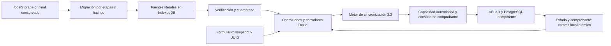

# NexLift v4.0 — Fase 3.3

Estado: **COMPLETADO en desarrollo y ensayo aislado**. Producción deshabilitada por defecto. Baseline PostgreSQL **PROVISIONAL**. No se avanza a 3.4.

## 1. Arquitectura y límites

`client/src/storage/` implementa persistencia local desacoplada del transporte y del motor de la fase 3.2. La interfaz `create/get/list/record/subscribe/withLock` permanece igual. La selección del adaptador ocurre en `operationRuntime.js`; no existe otro motor de sincronización.

La base `nexlift-offline` contiene operaciones, estados, comprobantes, borradores y revisiones recuperables. Los payloads de operaciones se almacenan una sola vez en el modelo operativo; las copias literales del origen se conservan separadamente como respaldo de migración. IndexedDB no cifra los datos del dispositivo ni constituye una barrera contra scripts del mismo origen.

## 2. Dependencia y documentación consultada

Dexie **4.4.6**, dependencia de producción fijada exactamente en `client/package.json` y `client/package-lock.json`. Compatible con React 19/Vite y validada con Node 24.22.0; sin Dexie Cloud, servicios externos ni dependencias de simulación de IndexedDB.

Se consultaron las fuentes oficiales: [diseño, índices y versionado](https://dexie.org/docs/Tutorial/Design), [transacciones](https://dexie.org/docs/Dexie/Dexie.transaction()), [upgrade](https://dexie.org/docs/Version/Version.upgrade()) y [VersionError y adaptación de versiones nuevas](https://dexie.org/docs/DexieErrors/Dexie.VersionError). Los límites y las transacciones descritos abajo siguen esas reglas; las verificaciones de integridad y el protocolo de migración son decisiones de NexLift.

## 3. Archivos de esta fase

Nuevos módulos de almacenamiento: `database.js`, `operationRepository.js`, `draftRepository.js`, `migrationService.js`, `coordination.js`, `storageHealth.js`, `runtime.js` y `usePreparedDraft.js`.

Nuevos componentes: `DraftBoundary.jsx` y `OfflineStorageStatus.jsx`. Cambios de integración: `operationRuntime.js`, `Workout.jsx`, `EditSession.jsx`, `SyncStatus.jsx`, ambos archivos de dependencias del cliente y `client/.env.example`.

Ensayos nuevos: `client/test/storage-harness.html`, `client/test/storage-cases.js`, `server/test/fixtures/storage-browser.mjs`, `storage.integration.test.js`, `run-storage-integration.mjs`, `check-storage.mjs` y `verify-storage.mjs`. `server/package.json` incorpora `test:storage:integration` y `verify:storage`. README enlaza este informe. Los comprobantes públicos están en esta carpeta. El helper CDP de `sync-browser.mjs` también recibe una corrección de cierre descrita en la sección 12; sus casos y aserciones se conservan.

No se cambian backend de negocio, contrato API, fórmulas, Personal Records, schema Prisma, migraciones, transporte, motor de sincronización, cola antigua ni Service Worker. El estado sucio previo del repositorio se conserva.

## 4. Esquema y versionado local

Versión actual Dexie **2**, versión física IndexedDB **20**. La declaración v1 se conserva; v2 agrega el índice `sources.type` y registra el upgrade en metadatos. Una instalación nueva crea directamente el esquema actual. Un upgrade abortado revierte su transacción. No se borra ni recrea la base al fallar. Se rechaza una versión física futura aunque Dexie se adapte a ella silenciosamente.

| Tabla | Identidad e índices | Contenido |
| --- | --- | --- |
| operations | `[ownerId+id]`, ownerId, `[ownerId+status]`, createdAt, multiEntry dependsOn | Sobre inmutable original; estado actual, intentos y error; dependencias |
| events | `[ownerId+operationId+id]`, `[ownerId+operationId]` | Historial de estados y errores, secuencia y fecha |
| receipts | `[ownerId+operationId]`, ownerId, confirmedAt | Resultado verificado completo y recurso remoto contenido en él |
| drafts | `[ownerId+id]`, `[ownerId+kind+resourceId]`, updatedAt | Última revisión, contenido original, día, fechas y recuperación |
| draftVersions | `[ownerId+id+version]`, `[ownerId+id]` | Todas las revisiones; no se purgan |
| sources | id SHA-256 único, key, ownerId, status, type | Texto literal por revisión legacy, hash y clasificación; secretos excluidos |
| metadata | key única | Esquema, creación de operaciones, estado y comprobante de migración |
| leases | key única | Titular, generación de fencing y vencimiento |

El UUID es la identidad lógica de una operación; no hay claves autoincrementales. `operationType`, `performedAt`, `expectedVersion` y el hash siguen en el sobre/payload original. No se duplican como índices innecesarios.

## 5. Auditoría de claves y clasificación

Se inspeccionaron todos los usos de localStorage/sessionStorage del código del cliente, CacheStorage del SW y los mecanismos de exportación. No existía IndexedDB en el código de aplicación anterior.

| Clase | Claves/origen | Decisión |
| --- | --- | --- |
| A: migrables | `nexlift_operation_v1:<ownerCodificado>:<UUID>:payload` y `:event:<UUID>` | Copia literal; validar estructura, dueño de la clave, UUID, hash, día, payload y comprobantes antes de habilitar reproducción |
| A: borradores válidos | `nexlift_draft_v2:<id>`; version 2, ownerId, kind, resourceId, originalDay, fechas y data | Copiar con ID original y revisión de recuperación; conservar sesión/versiones, RIR y lados |
| C: legado bloqueado | `nexlift_offline_queue` (array), `nexlift_offline_op_v2:<id>` (version 2), `workout_<dayId>` y otros `workout_*` | Respaldo literal, sin generar UUID nuevo ni inferir propietario/fecha/protocolo; revisión explícita |
| C: datos inválidos | JSON corrupto, dueño ausente/incompatible, fecha ambigua, hash incorrecto, evento huérfano, colisión de identidad | Conservar en origen y cuarentena; no envío automático |
| B/E: autenticación | `nexlift_token`, `nexlift_user`, `nexlift_verified_identity_v1:<owner>` | Continúan en su ubicación actual por compatibilidad; jamás se copian a IndexedDB. La prueba de identidad de 3.2 sigue en localStorage |
| B: preferencias | `nexlift_lastExercise` | Permanece en localStorage |
| D: regenerables | `nexlift_home_v3` en sessionStorage; `nexlift-static-*` y shell/assets del SW | No se migran; no son evidencia de operaciones confirmadas |
| D: coordinación antigua | `nexlift_operation_v1:lease:<owner>` | No se importa; el lease nuevo tiene elección transaccional propia |
| E: secretos inesperados | Campos token/password/authorization/secret/JWT y cadenas JWT en registros permitidos | Rechazar persistencia nueva. Si aparecen en legado, conservar solamente en origen y registrar hash/razón sin el texto sensible; excluirlos de la exportación nueva |

La lista de claves permitidas es explícita. No se copia todo localStorage. No se elimina ninguna clave legacy. Los formatos no reconocidos no se asignan a la cuenta conectada.

## 6. Migración recuperable e idempotente

1. Enumerar solo claves permitidas y construir un snapshot ordenado con sus textos originales.
2. Calcular SHA-256 del snapshot y de cada valor fuera de transacciones. La identidad de una fuente es SHA-256 de clave, separador y texto literal: revisiones distintas nunca se pisan.
3. Transacción de copia: guardar fuentes y metadatos `copying`, `verified:false`, `finalCutover:false`.
4. Validar sobres y hashes fuera de transacciones. Importar operaciones, eventos, comprobantes y borradores en lotes de 100, idempotentes por sus identidades originales.
5. Leer de vuelta fuentes, hashes, IDs, sobres, eventos y contenido de borradores; contrastar copia literal y representación operativa.
6. Releer localStorage. Si cambió durante el proceso, registrar `reconciling`, dejar `verified:false`, detener el uso del adaptador y reconciliar al siguiente intento. Solo una copia estable y verificada permite usarlo.

`watching` significa copia inicial verificada con vigilancia continua. `review` significa copia conservada con registros bloqueados. Ninguno implica retirar localStorage: **`finalCutover` permanece siempre falso**. No se declara un corte definitivo mientras puedan existir pestañas antiguas.

Cada lectura/escritura del adaptador y cada inicio de procesamiento vuelve a reconciliar; el fingerprint evita reinterpretar fuentes sin cambios. El evento `storage` detecta otras pestañas. Una escritura antigua posterior se añade con su propio hash. Los eventos tardíos se importan por ID; confirmado es absorbente. Una colisión de payload bajo la misma identidad bloquea la operación y conserva las dos fuentes. Un evento corrupto u huérfano no se convierte en éxito.

No existe ACID entre localStorage e IndexedDB: la seguridad procede de etapas recuperables, verificación y conservación de ambos orígenes. Una pestaña antigua puede escribir inmediatamente después de cualquier escaneo; por eso el corte definitivo queda bloqueado. La operación aparecerá en la siguiente reconciliación. La garantía remota frente a reenvíos sigue en PostgreSQL.

## 7. Atomicidad

Crear operación y metadatos usa una sola transacción. Registrar un estado, su evento y el comprobante usa otra, incluyendo el lease para comprobar fencing. Si falla cualquier escritura, se revierte todo; nunca se confirma solo el estado sin su comprobante. Los errores no cambian el payload.

Guardar borrador y revisión es atómico, con comparación de versión. La copia de fuentes y los metadatos de cada etapa también son transaccionales. Los errores de base se propagan fuera del callback, sin capturas que oculten un rollback.

No se mantienen transacciones durante HTTP, temporizadores, WebCrypto ni checkpoints del ensayo. La validación/hash ocurre antes y la notificación después del commit. No hay éxitos anticipados ni fallback a una cola en memoria.

## 8. Coordinación entre pestañas

Se conserva el Web Lock `nexlift-operation-sync:<owner>` de 3.2 para coordinarse con esa versión. Además, una transacción IDB elige un lease por propietario: 60 segundos, renovación cada 20 y generación creciente. Cada escritura del sincronizador comprueba titular, generación y vencimiento dentro de la misma transacción de actualización. Un líder congelado que perdió el lease no puede aplicar una respuesta tardía.

BroadcastChannel transmite solo una señal de cambio; los suscriptores releen la base. No concede exclusividad ni transmite payloads/cuentas. Sin Web Locks funciona la elección transaccional. Si un Web Lock sigue retenido por una pestaña congelada, otra no lo roba: los datos esperan hasta reanudación/cierre. Un lease abandonado se recupera al vencer; un salto del reloj puede retrasar o adelantar esa elección, sin sustituir el fencing ni la idempotencia SQL.

Se probaron adaptadores concurrentes, pestañas reales, congelación mediante CDP, expiración controlada, cierre sin liberación y reinicios. También se comprueba que una renovación ya encolada, ejecutada después de liberar liderazgo, no sobrescriba al nuevo titular: la renovación valida el fence capturado, aunque su entrada ya no exista en el mapa activo. Las pruebas de expiración usan reloj adelantado/controlado; no simulan un corte eléctrico.

## 9. Errores y recuperación

Se manejan MissingAPI/IndexedDB restringido, cuota, VersionError/esquema futuro, bloqueo de upgrade, DatabaseClosedError y fallos de lectura/escritura. La sección local muestra errores y conserva advertencias de escritura durante la sesión; una lectura posterior no las convierte en un éxito de guardado. Se mantiene el mensaje del formulario y la posibilidad de exportar originales accesibles cuando IDB no abre.

Los originales no se reemplazan ni purgan. Reabrir reanuda una migración incompleta y reconstruye las copias a partir de fuentes existentes. El respaldo JSON por cuenta incluye operaciones, eventos, comprobantes, borradores, todas sus versiones, fuentes y metadatos. La opción adicional de exportar registros sin dueño es explícita; no los asigna a la cuenta. Los journals con dueño conocido, incluso corruptos, se restringen a esa cuenta. No hay importación automática de un JSON de respaldo sin revisión en esta fase.

Desactivar la flag no borra IndexedDB, pero el frontend antiguo no podrá mostrar operaciones creadas exclusivamente allí. Una reversión exige conservar/exportar esa base y reactivar un cliente compatible para procesarlas; no debe interpretarse como permiso para borrar la base ni volver a introducir entrenamientos manualmente.

## 10. Borradores y aislamiento

`DraftBoundary` prepara y recupera IndexedDB antes de montar los editores. El formulario no arranca vacío y sobrescribe un borrador mientras todavía se está leyendo. La UI conserva el contrato de carga inicial mediante un contexto; sus guardados esperan confirmación asíncrona. Finalizar un entrenamiento espera al guardado del borrador y conserva la pantalla si falla.

Cada instancia de editor tiene UUID estable; sus guardados se serializan, actualizan la versión y conservan cada revisión. Un editor recuperado copia a su propia identidad: otra pestaña no sobrescribe el borrador anterior. Los borradores de entrenamiento mantienen la restricción del día CDMX de 1.2; los de sesión conservan el `expectedVersion` revisado. Dos revisiones legacy de la misma identidad y fecha con contenidos distintos se conservan y requieren revisión, sin elegir silenciosamente una para cargar.

Las operaciones, consultas de UI y exportaciones se filtran por propietario. Los borradores comprueban la identidad actual antes de cargar/guardar y justo antes de su escritura. La integración de formulario exige la vinculación previamente verificada por servidor de 3.2. B no recibe los datos de A; al volver A recupera su cola. Una respuesta tardía de A no confirma bajo B.

## 11. Compatibilidad con el protocolo remoto

Sin cambios al contrato 3.1, hash canónico, UUID, performedAt, día original, notas, sets, pesos/reps de ambos lados, RPE/RIR, completed, expectedVersion ni dependencias. Se mantiene el mismo motor: capacidad autenticada antes de escribir, consulta de comprobante antes de POST, validación completa del acuse, backoff/Retry-After, pausa 401, conflictos 409 y retención de 429/503.

Las colas de 1.2 permanecen protegidas en su ubicación original y se copian como legado bloqueado; no se transforman en operaciones 3.1. El SW conserva API solo por red y no recibe JWT ni implementa otro sincronizador. La app debe estar abierta o reabrirse; no se promete envío en segundo plano con la PWA cerrada.

## 12. Pruebas y resultados

**Validación completa aprobada:** 32 comandos finalizaron con código 0, usando Node 24.22.0/npm 11.19.1, Prisma 6.19.3 y PostgreSQL 18.4 nativo. Desde `server`, `node test/verify-storage.mjs` utiliza una copia privada sin archivos .env operativos, `npm ci` de servidor/cliente, generación Prisma y PostgreSQL desechable. Conserva todos los casos y aserciones históricos: primero 730 sobre baseline original y después los 70 de 3.1 y los 70 de 3.2 sobre su migración provisional real. No se omiten pruebas existentes.

Una primera matriz se detuvo en el helper de navegador de 3.2: Edge cerró el socket de CDP antes de contestar `Browser.close`, generando un timeout de instrumentación tras aprobar los otros 18 casos de esa suite. Se corrigió el helper para aceptar la desconexión exclusivamente al esperar ese comando; los demás comandos pendientes siguen fallando al desconectarse. Se mantienen el cierre/reinicio real y todas las comprobaciones de persistencia. La matriz final se repitió desde una copia limpia después de esa corrección y pasó completa.

Los ensayos nuevos usan Edge real con Dexie e IndexedDB nativos, HTTP real y PostgreSQL 18 desechable; no fake-indexeddb. Cubren instalación, 1.000 operaciones, datos 1.2/3.2, migración repetida, interrupciones en tres etapas, cierre real después de copia, transacción interrumpida al cerrar pestaña, fallos entre tablas, cuotas inyectadas, corrupción/fechas ambiguas/secretos, borradores/revisiones/colisiones, cuentas, eventos tardíos, leases, conflictos, auth, backoff, dependencias, exportación, upgrades/bloqueos y recuperación tras reinicio con SW real.

Las condiciones de cuota y fallo de escritura se inyectan como excepciones dentro de transacciones IDB reales. No se llenó físicamente el disco, no se probó corte eléctrico y no se promete durabilidad física absoluta. Para el cierre con una transacción activa se acepta solamente cero o todas las filas, con su marcador transaccional consistente.

Pasaron el build con flags desactivadas y el build de ensayo con ambas activadas. Los archivos nuevos tienen cero errores/advertencias de lint. El lint global mantiene exactamente los 27 errores y 3 advertencias históricos, sin regresiones; no se presenta como un lint global limpio.

## 13. Total acumulado y evidencias

**917 pruebas acumuladas aprobadas.**

| Grupo | Pruebas |
| --- | ---: |
| Históricas hasta fase 3.1 | 800 |
| Cliente fase 3.2 | 51 |
| PostgreSQL/navegador fase 3.2 | 19 |
| IndexedDB/Dexie, navegador y verificación SQL fase 3.3 | 47 |
| Total único | **917** |

Las 47 nuevas incluyen 46 escenarios de navegador y la verificación final de integridad SQL del ensayo contenedor. Las 48 pruebas de humo repetidas después de retirar dependencias de desarrollo no se suman otra vez. Tampoco se suman los ensayos enfocados ni la matriz inicial fallida. La última matriz se cerró a `2026-10-19T02:23:06.296Z` (18 de octubre en CDMX).

Evidencia de navegador: [integration-evidence.json](./integration-evidence.json). Matriz, comandos y **53 hashes verificados contra el código actual**: [phase33-evidence.json](./phase33-evidence.json). Verificación de **20 artefactos protegidos sin cambios** respecto a 3.2 y timestamp del estado de staging persistente: [preservation-evidence.json](./preservation-evidence.json). Los informes de 3.1/3.2 permanecen conservados; sus evidencias no se sobrescriben.

El ensayo final remoto dejó 10 logs, 20 series, 3 descansos y 13 comprobantes sintéticos, sin comprobantes huérfanos. Los dos reinicios reales, la migración interrumpida después de copiar, el lease de pestaña congelada, SW real y cola de 1.000 se registran en la evidencia. Los clusters/HTTP/perfiles de prueba se detuvieron y retiraron; la copia de verificación exitosa se elimina tras finalizar.

La revisión automática rechazó la limpieza recursiva de la copia de la primera matriz fallida con el motivo `blocked by policy`. No se reintentó por otra vía. Permanece la carpeta privada `C:\Users\guerr\AppData\Local\Temp\nexlift-phase33-verification-D7hT86`, con código/dependencias y logs sintéticos del ensayo, sin servicios activos. Esta retención no afecta a la aplicación ni al staging persistente.

## 14. Navegadores y retención

Se consultaron las políticas oficiales de [Edge](https://learn.microsoft.com/en-us/microsoft-edge/progressive-web-apps/how-to/offline), [Chromium/web.dev](https://web.dev/articles/storage-for-the-web), [almacenamiento persistente en Chromium](https://web.dev/articles/persistent-storage) y [WebKit/Safari y apps de pantalla de inicio](https://webkit.org/blog/14403/updates-to-storage-policy/).

La UI detecta `navigator.storage.estimate`, `persist` y `persisted`, muestra uso/cuota aproximados y solicita persistencia solamente con un botón del usuario. La concesión depende del navegador; una denegación o API ausente no elimina datos ni promete conservación. Persistencia no impide el borrado explícito por usuario/sistema; mantener exportaciones sigue siendo necesario.

Solo se ensayó Edge de escritorio real en Windows. El ensayo de PWA corresponde al origen real con Service Worker, recarga y reinicio del navegador con el mismo perfil; no a la instalación y relanzamiento desde el sistema operativo. Chrome comparte motor pero no se ejecutó un binario Chrome independiente. No había Safari/macOS ni iPhone/PWA instalada disponibles: compatibilidad basada en documentación y feature detection, pendiente de ensayo físico. El modo privado/restringido se representa por ausencia de API/fallos explícitos; no se afirma haber probado todas sus políticas reales.

## 15. Flags, producción y riesgos pendientes

Se requieren **ambas** `VITE_WORKOUT_OPERATIONS_ENABLED=true` y `VITE_INDEXEDDB_ENABLED=true` para seleccionar el adaptador Dexie. Los ejemplos mantienen ambas falsas. Sin ellas no se abre la base automáticamente. El build de desarrollo/ensayo puede habilitarlas; el backend sigue con su hardlock de producción de 3.2 y su comprobación de capacidad SQL. Un error local o una API incompatible no activa el transporte legacy como fallback.

Para una futura habilitación de producción son necesarios: validar la baseline todavía PROVISIONAL y el journal 3.1 contra una fuente autorizada, aprobar el procedimiento de migración/despliegue, comprobar la recuperación y los navegadores objetivo, servir un frontend/backend compatibles y definir un procedimiento para retirar respaldos antiguos. Nada de ello se ejecuta en esta fase.

Para 3.4 quedan la resolución explícita de conflictos, revisión/importación de respaldos exportados, tratamiento de legado sin dueño y experiencia de recuperación de días anteriores. No hay rebase automático ni limpieza por antigüedad. No se ha aprobado retirar fuentes originales, comprobantes ni revisiones. Una pestaña antigua no cooperante impide un corte definitivo; la vigilancia y ambos orígenes deben conservarse.

**No hubo acceso a PostgreSQL de producción ni a bases persistentes; solo clusters nuevos, identificados y desechables con datos sintéticos. No se ejecutaron migraciones sobre staging persistente. No hubo commits, despliegues, llamadas a proveedores ni cambios en algoritmos/PR.** El staging 2.4 conserva su estado privado original sin lectura de credenciales.

## 16. Estado final

**COMPLETADO en desarrollo y ensayo aislado.** Los criterios se verificaron dentro de los límites de plataforma declarados. Producción permanece sin habilitación; baseline y journal SQL siguen provisionales. El corte definitivo de fuentes legacy continúa bloqueado por diseño mientras no exista reconciliación y retirada explícitamente aprobada. No se avanza a la fase 3.4.
